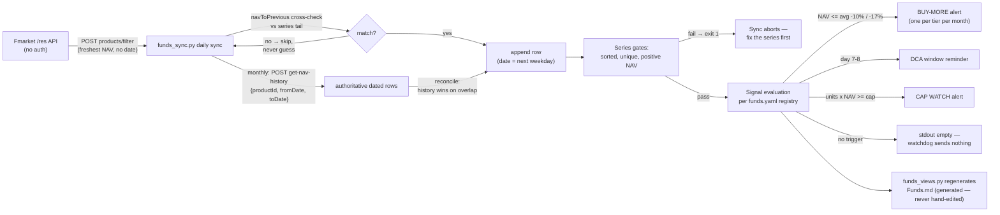

# petasos-fmarket-nav

A Hermes Agent skill for monitoring Fmarket.vn fund NAVs into an Obsidian
vault as per-fund JSONL series, with signal alerts and a generated view.

Fmarket-API-only by design — two unauthenticated endpoints, no scrapers in the
sync path:

- **DAILY — `POST /res/products/filter`**: each fund's freshest NAV (published
  the same evening) but **no trade date**. A row is appended only when the
  record's `productNavChange.navToPrevious` matches the change from the series
  tail to within rounding; the date is then inferred as the next weekday after
  the tail (VN public holidays are not modelled). Any mismatch = skip and wait
  for the monthly reconcile — the sync never guesses a value or a date, so a
  broken feed pauses the series instead of corrupting it.
- **MONTHLY — `POST /res/product/get-nav-history`** (auto on day 1,
  `FUNDS_MONTHLY_DAY` to move it, `--monthly` to force): authoritative dated
  rows for the trailing ~45 days, reconciled over the file — history values
  win on every overlapping date, so any mis-inferred daily row (holiday,
  missed cron) self-heals. A frozen history feed simply no-ops.

Plus:

- **Per-fund append-only series** as the single source of truth —
  `_Ledger/funds-series/<CODE>.jsonl`, one `{"date", "nav", "fetched_at"}` per line,
  sorted, unique dates, deduped on append; hand-editing is disallowed
  (re-seed with `funds_backfill.py --force`, which merges, dedupes and sorts)
- **All intelligence is DATA you own**: `funds.yaml` in your vault (fund ids,
  avg cost, units, cap, DCA schedule, buy-more thresholds) shadows the bundled
  synthetic example — the engine is generic and never user-edited; adding a
  fund is one registry row plus one backfill
- **Signals over dashboards**: buy-more thresholds vs your avg cost, DCA
  day-window reminders, portfolio-cap watch — one alert per tier per month,
  printed to stdout (cron watchdog delivers; silence = nothing to report)
- **Loud failures**: a missing registry, malformed YAML, duplicate keys,
  unsorted series, or a duplicate date all exit nonzero naming the file and
  line — never a silent fallback
- **Safe preview**: `--dry` fetches and evaluates the full plan but writes
  nothing
- **Generated view**: `Funds.md` (latest NAV, 1m/3m/12m change, value vs avg
  cost, unrealized P&L) — never hand-edited; series gates must pass for the
  note to be written (exit 0)

Python 3.10+ stdlib + PyYAML (`pip install pyyaml`) — the only dependency,
and its absence fails loud by design (exit 2 with the install hint).

## How it works



## Use cases

| Use case | How it runs |
|---|---|
| Daily hands-off sync | Blueprint cron (20:00) or `scripts/funds_sync.py` — freshest-NAV fetch, cross-check, append, signals, views |
| Monthly authoritative heal | automatic on day 1 (`--monthly` to force) — `get-nav-history` reconcile |
| Safe preview | `scripts/funds_sync.py --dry` — fetches and evaluates, writes NOTHING |
| Regenerate the view + series gates | `scripts/funds_views.py` — exit 0 iff every series passes |
| Track a new fund | One `funds.yaml` row (find the product id via `/res/products/filter`) + `scripts/funds_backfill.py --code X --fetch --force` |
| Migrate a legacy series | `scripts/funds_backfill.py --code X --from-jsonl old.jsonl` — merges, dedupes, sorts |
| Local data stale / mis-dated | `scripts/stockbiz_nav_series.py` (offline repair) + `funds_backfill.py --from-jsonl ... --force` |
| Registry edited | Re-run `--dry` — a malformed registry fails loudly before any write |

## Install

This repository is private: `hermes skills install` fetches GitHub
unauthenticated and cannot read it — copy the tree into your profile's
`skills/` directory instead (and keep the repo as versioned source).

```
pip install pyyaml
```

## Quickstart

```bash
# 1. Point the skill at your vault (ledger dir defaults to 2-Areas/Finance/_Ledger)
export FUNDS_VAULT=/path/to/your/vault

# 2. Copy the bundled registry example into the vault and make it yours
cp templates/funds.yaml "$FUNDS_VAULT/2-Areas/Finance/_Ledger/funds.yaml"
#    -> set code / product_id / avg_cost_nav / units / cap / dca / thresholds

# 3. Dry-run (fetch + evaluate the full plan, writes nothing)
python3 scripts/funds_sync.py --dry

# 4. Live sync + regenerate Funds.md (series gates must pass)
python3 scripts/funds_sync.py
```

Then add the companion cron (watchdog pattern: silent unless a signal fires):

```bash
# wrapper prints ONLY signal lines; empty stdout sends nothing
python3 scripts/funds_sync.py --quiet
```

### Fmarket API prerequisites

The skill talks to Fmarket's unauthenticated `/res/` API directly — no login,
key, or cookie needed:

- `POST https://api.fmarket.vn/res/products/filter` — fund lookup AND the
  daily NAV source (`{"types": ["NEW_FUND", "TRADING_FUND"], "searchField":
  "...", "page": 1, "pageSize": N}`): the record carries the freshest `nav`
  (published the same evening) plus `productNavChange.navToPrevious` — the
  cross-check that dates the row. `navDate`/`updateAt` are null/unrelated and
  must never be used as a trade date.
- `POST https://api.fmarket.vn/res/product/get-nav-history` —
  `{"productId": <int>, "fromDate": "YYYY-MM-DD", "toDate": "YYYY-MM-DD"}`
  returns rows `{nav, navDate}` at weekday cadence — the monthly reconcile
  source of truth (ISO dates only; epoch-ms gets a misleading HTTP 500).
- The `/rest/` path family requires login; don't use it. NAVs publish in the
  evening (VN) — schedule the cron after ~19:30 or it re-fetches yesterday.

## Exit codes (the contract)

| Command | 0 | 1 | 2 | 3 |
|---|---|---|---|---|
| `scripts/funds_sync.py` | ok (signal lines on stdout if any) | series/data error | config error | Fmarket unreachable |
| `scripts/funds_views.py` | gates pass + `Funds.md` written | series gate failure | config error | — |
| `scripts/funds_backfill.py` | seeded | data error | target exists (use `--force`) / fund not in registry | — |

See SKILL.md → "Procedure" and "Pitfalls" for the full command list and the
live-API quirks (date formats, window limits, publish times).

## Adapting to your setup

Designed to be fund- and vault-agnostic, and every knob is env or data —
never a source edit:

- **Your vault** — `FUNDS_VAULT` (required) or `skills.config.petasos.vault_path`.
- **Your layout** — `FUNDS_LEDGER_DIR` if you don't use the PARA default
  (`2-Areas/Finance/_Ledger`).
- **Your funds** — `funds.yaml` in the vault, shadowing the bundled synthetic
  example (`$FUNDS_REGISTRY` overrides everything; a missing explicit path is
  a LOUD error).
- **Your source** — `FUNDS_API_BASE` if you mirror the Fmarket API elsewhere.
- **Your heal day** — `FUNDS_MONTHLY_DAY` (default `1`) moves the monthly
  `get-nav-history` reconcile; `--monthly` forces it any day.

See SKILL.md → "Registry (data, never code)" for the full field table.

## Privacy

This repository ships a synthetic registry and shape-faithful fixtures only:
no real fund ids tied to a person, no holdings, no avg costs, no caps. Your
real registry and series live in your vault, which is yours and stays outside
the repo. The test suite carries a privacy sweep that fails the build if any
user-specific figure ever enters the tree.

## License

MIT — see [LICENSE](LICENSE).
